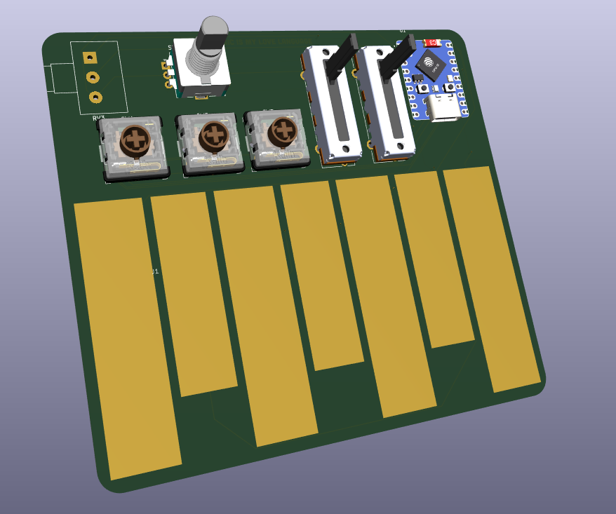
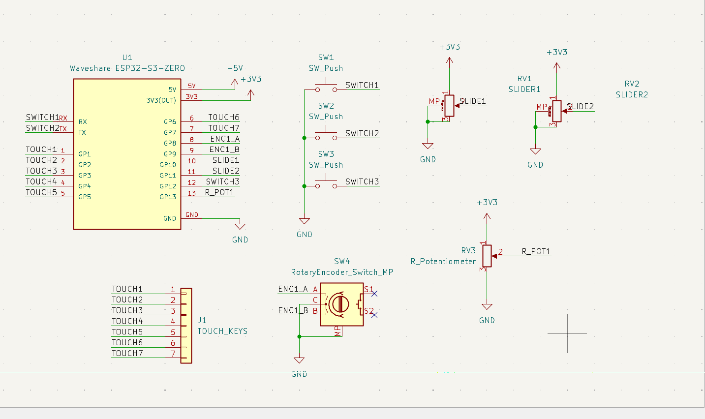

# MIDI Keypad

()

A custom USB MIDI controller built from scratch following Kai's MIDI Keypad tutorial. No stock firmware, no base project to extend, the tutorial hands you a KiCad library and component options and says figure out your own layout, so this is my own hardware config and (once I get to it) my own firmware mapping it to MIDI.

## What it is

7 capacitive touch keys mapped to a scale off a root note, plus a rotary encoder for octave shifting, two slide potentiometers and a rotary potentiometer for CC control (mod wheel, volume, filter cutoff), and 3 push buttons rounding out the control surface. Everything runs off a Waveshare ESP32-S3-Zero, through-hole and SMD components on a single PCB.

### Layout

| Control | Function |
|---|---|
| TOUCH1–7 | 7 notes, chromatic from a root note (capacitive touch, exposed copper pads) |
| Rotary encoder | Octave shift up/down |
| Encoder push | Reset to default octave |
| Slider 1 | Mod wheel (CC1) |
| Slider 2 | Volume (CC7) |
| Rotary pot | Filter cutoff / expression (CC11) |
| SW1–3 | Extra notes / mode switches (TBD) |

## Why?

Unlike a guide that hands you a finished sketch and hardware spec, this tutorial is intentionally open ended, pick your own components, your own layout, your own firmware. So there's no "stock" version to diverge from here, the departure from the guide is the whole point of following it. What's here is my own schematic built off the tutorial's component options (capacitive touch keys, EC11 encoder, slide pots), with my own control mapping on top.

## Status

Schematic and PCB layout are done in KiCad, board hasn't been fabbed or ordered yet. Firmware hasn't been written. This readme documents the plan, not a finished build, updating as I actually get hardware in hand and start writing code.

## Bill of materials (BOM)

### Bill of materials (BOM)

| Item | Description | Qty | Unit Price (USD) | Line Total (USD) | Link |
|------|-------------|-----|------------------|------------------|------|
| 1 | Waveshare ESP32-S3-Zero, main microcontroller | 1 | $6.06 | $6.06 | [Robocraze](https://robocraze.com/products/waveshare-esp32-s3-zero-development-board-240mhz) |
| 2 | EC11 15 mm rotary encoder module with push switch | 1 | $0.70 | $0.70 | [Robocraze](https://robocraze.com/collections/sensors?page=21) |
| 3 | Kailh Choc low-profile push-button switches | i coduln'd find these but i have these |
| 4 | Bourns 10k slide potentiometer, 45 mm travel, 15 mm shaft, pack of 2 | 1 pack | $18.10 | $18.10 | [Amazon India](https://www.amazon.in/BOURNS-Potentiometer-Travel-Single-Linear/dp/B079ZP3LS5) |
| 5 | 10k rotary potentiometer with knob | 1 | $0.36 | $0.36 | [Robocraze](https://robocraze.com/products/10k-pot-potentiometer-with-knob) |
| 6 | Capacitive touch pads — exposed copper on PCB | 7 | $0.00 | $0.00 | PCB feature, no separate part |
| 7 | 1×40 2.54 mm female header strip, for ESP32-S3-Zero mounting | 1 | $0.13 | $0.13 | [Robocraze](https://robocraze.com/products/40x1-female-berg-strip) |
| 8 | Optional: 6×6×8 mm tactile buttons, 10-pack, if not using Choc switches | 1 pack | $0.21 | $0.21 | [Robocraze](https://robocraze.com/collections/push-buttons) |
| 9 | JLCPCB 2-layer PCB, up to 100×100 mm, 5 pcs | 1 order | From $2.00 | From $2.00 + shipping | [JLCPCB](https://jlcpcb.com/ads/pcb-prototype) |
| | **Known-parts subtotal** | | | **$25.34** | |
| | **Grand total** | | | **$27.34 + PCB shipping + unresolved Choc switches** | |

## Software

Planning to use TinyUSB or Arduino MIDI library for USB MIDI over the ESP32-S3. Nothing written yet, will add once the board's in hand.

## Known issues

Nothing as far as i know